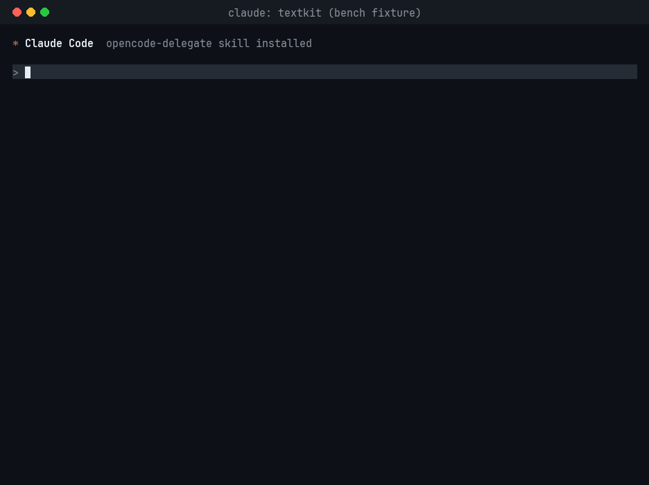

# opencode-delegate

[English](README.md) | [Français](README.fr.md) | [简体中文](README.zh-CN.md) | [日本語](README.ja.md)

一个 [Claude Code](https://claude.com/claude-code) 技能，把低判断力的苦力活交给免费的 [opencode](https://opencode.ai) 模型，让 Claude 的用量用在真正需要的地方。

Claude 保持主导权。它决定什么值得委托，撰写提示词，通过沙箱化的 worker 运行免费模型，然后自己审查 diff 并运行测试。



一次真实的 Claude Code 会话在 benchmark fixture 上运行，等待时间已剪掉。它花费了 $0.31 的 Claude 用量。同样的任务不用这个技能平均花费 $0.63。

## 你会得到

- **`skill/SKILL.md`**：告诉 Claude 何时委托（样板代码、测试、文档、fixtures、跨文件的编辑），何时不委托（设计、棘手的 bug、安全），以及如何审查结果。
- **`bin/oc-delegate`**：通过免费模型的回退链运行 worker。如果某个模型失败或卡住，只回滚它编辑过的文件并尝试下一个模型。你自己的未提交更改会被保留。
- **`opencode/cc-worker.md`**：一个锁定的 opencode agent。它可以读写仓库中的文件，仅此而已：没有 shell、没有网络、没有 `.git`、`.env*`、密钥或凭据文件。
- **`claude-md-snippet.md`**：一段 `CLAUDE.md` 内容，让 Claude 默认把苦力活委托出去。没有它，Claude 很少会自己选用这个技能。

## 环境要求

| 需要 | 说明 |
| --- | --- |
| Claude Code | 任何支持技能的近期版本。 |
| [opencode](https://opencode.ai) | 测试过 v2.0.32 和 v2.1.3。免费的 OpenCode Zen 模型无需 API 密钥。 |
| `bash`、`git`、`jq` | |
| GNU coreutils | Linux 自带。macOS 上用 Homebrew 安装 `coreutils`，并把其 `gnubin` 目录放到 `PATH` 最前。 |
| `~/.local/bin` 在 `PATH` 上 | 安装器把 `oc-delegate` 放在这里。 |
| `bwrap`（可选，Linux） | [bubblewrap](https://github.com/containers/bubblewrap) 把 worker 的文件写入限制在仓库内。推荐。 |

如果没有 opencode，请先安装，然后确认它能列出免费模型：

```sh
curl -fsSL https://opencode.ai/install | bash
opencode models | grep -E -- '-free|big-pickle'
```

## 安装

### 让 Claude Code 来做

把这段贴到 Claude Code：

```text
请为我从 https://github.com/EldinBegano/opencode-delegate 安装 opencode-delegate 技能。

1. 检查其 README 中的环境要求：bash、git、jq、GNU coreutils 和 opencode。如果有缺失，告诉我如何在我的系统上安装，并停止。不要自己安装系统软件包。
2. 将仓库克隆到 ~/.local/share/opencode-delegate，如果已存在则 git pull。阅读 install.sh，然后运行它。如果它警告 ~/.local/bin 不在 PATH 上，告诉我应添加到 shell 配置的行。
3. 将 "Bash(oc-delegate:*)" 添加到 ~/.claude/settings.json 的 permissions.allow 中，并保留该文件中的其他内容。如果无法编辑，给我展示要添加的确切 JSON。
4. 将 claude-md-snippet.md 追加到 ~/.claude/CLAUDE.md，除非该文件已有 "# opencode delegation" 段落。
5. 在一个临时 git 仓库中运行 README 中的冒烟测试，向我展示 oc-delegate 的输出和 git diff。
6. 总结你做了什么改动。不要批准任何仓库用于委托；我将在你首次询问时回答。
```

之后启动一个新的 Claude Code 会话，以便技能和 `CLAUDE.md` 段落被加载。

### 手动

1. 克隆并安装：

   ```sh
   git clone https://github.com/EldinBegano/opencode-delegate.git
   cd opencode-delegate
   ./install.sh
   ```

   安装器把技能、worker agent 和 `oc-delegate` 以符号链接形式放到 `~/.claude/skills/`、`~/.config/opencode/agents/` 和 `~/.local/bin/`，因此 `git pull` 就能更新它们。用 `./install.sh --copy` 改为复制。已有且内容不同的文件会先备份。

2. 让 Claude 无需每次都询问就能运行 wrapper。把这段加到 `~/.claude/settings.json`，合并进你现有的 `permissions.allow` 列表：

   ```json
   {
     "permissions": {
       "allow": ["Bash(oc-delegate:*)"]
     }
   }
   ```

3. 把 [`claude-md-snippet.md`](claude-md-snippet.md) 粘贴进 `~/.claude/CLAUDE.md`。别跳过这步：只装技能的话，Claude 倾向于自己写苦力活。该片段维护一份你已批准免费模型的仓库列表。Claude 在新仓库首次委托前会问你一次。

4. 冒烟测试：

   ```sh
   tmp=$(mktemp -d) && cd "$tmp" && git init -q
   printf 'a\nb\n' > list.txt && git add . && git commit -qm init
   oc-delegate "Append a line containing exactly 'c' to list.txt. Change no other file."
   git diff
   ```

   你应该看到 `model: opencode/...`、`M list.txt`，以及添加了 `c` 的 diff。

## 用法

大多数时候你什么都不用调。Claude 会委托大的苦力活，比如跨多个模块的 docstring 或测试，并告诉你免费模型做了什么、检查了什么。小任务故意留给 Claude，因为委托它们的成本大于收益。

要强制执行，说 "delegate this"、"use opencode" 或 "use the free model"，或输入 `/opencode-delegate`。

你也可以在任何 git 仓库里自己运行 wrapper：

```sh
oc-delegate "task"                                       # default model chain
oc-delegate -m opencode/deepseek-v4.1-flash-free "task"   # one model, no fallback
oc-delegate -c "pytest -q" "task"                        # run a check after the worker
```

配合 `-c`，失败的检查会回到 worker 修复，最多 `-r` 次（默认 2）。如果仍失败，则回滚该模型的编辑并尝试下一个模型。如果运行前检查已经失败，则跳过。

### 设置

| 变量 | 默认 | 作用 |
| --- | --- | --- |
| `OC_DELEGATE_MODELS` | 下面的链 | 未指定 `-m` 时使用的空格分隔模型链。 |
| `OC_DELEGATE_TIMEOUT` | `300` | 模型运行被杀死并尝试下一个模型前的秒数。 |
| `OC_DELEGATE_IDLE` | `180` | 无输出且无网络流量多少秒后认为模型卡死。 |
| `OC_DELEGATE_TOTAL` | `540` | 整次运行的秒数。保持在 Claude Code 的 600s Bash 超时之下。 |
| `OC_DELEGATE_CHECK` | 无 | 未指定 `-c` 时使用的检查命令。 |
| `OC_DELEGATE_RETRIES` | `2` | 每个模型的检查重试次数，未指定 `-r` 时使用。 |
| `OC_DELEGATE_CHECK_TIMEOUT` | `120` | 每次检查运行的秒数。 |
| `OC_DELEGATE_SANDBOX` | `1` | 设为 `0` 以不使用 `bwrap` 运行。 |
| `OC_DELEGATE_TAIL` | `40` | 打印的 worker 摘要行数。 |
| `OC_DELEGATE_LOG` | `~/.local/state/oc-delegate.log` | 每次模型尝试的日志。用 `column -ts$'\t' ~/.local/state/oc-delegate.log` 查看。 |

### 模型

默认链是 `beam-free` → `deepseek-v4.1-flash-free` → `space-bunny-free` → `mimo-v2.6-flash-free` → `big-pickle`，全部在 `opencode/` 下。免费阵容经常变化。如果这些过时了，检查 `opencode models | grep free` 并设置 `OC_DELEGATE_MODELS`。顺序如何选定：[docs/development.md](docs/development.md#model-choice)。

## 隐私与安全

- **免费模型可能记录你的提示词并用于训练。** worker 在仓库里读到的所有内容都会发给该提供商。不要在机密仓库里委托。
- worker 的拒绝列表只匹配文件名。`config.yaml` 里的秘密仍然可读。
- worker 不能碰 `.git`。使用 `bwrap` 时，`.git` 也会以只读方式挂载。
- worker 可以编辑被 gitignore 的文件，而 `git diff` 不会显示它们。wrapper 会在 `not in git diff` 下列出它们。
- worker 不能运行测试或构建。Claude 验证结果。
- 不要在任务提示词里放秘密。

## 开发

运行 `bats test`（无网络，约一分钟）。测试、模型基准和技能评估在 [docs/development.md](docs/development.md) 中描述。

## 卸载

```sh
rm ~/.claude/skills/opencode-delegate/SKILL.md ~/.config/opencode/agents/cc-worker.md ~/.local/bin/oc-delegate
rmdir ~/.claude/skills/opencode-delegate
```

然后移除权限规则和 `CLAUDE.md` 段落。

## 许可证

[MIT](LICENSE)
